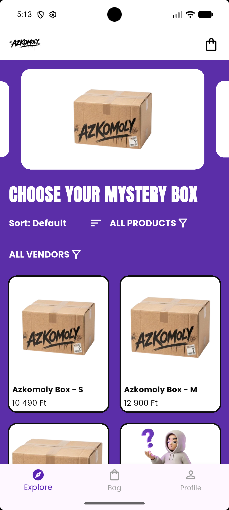
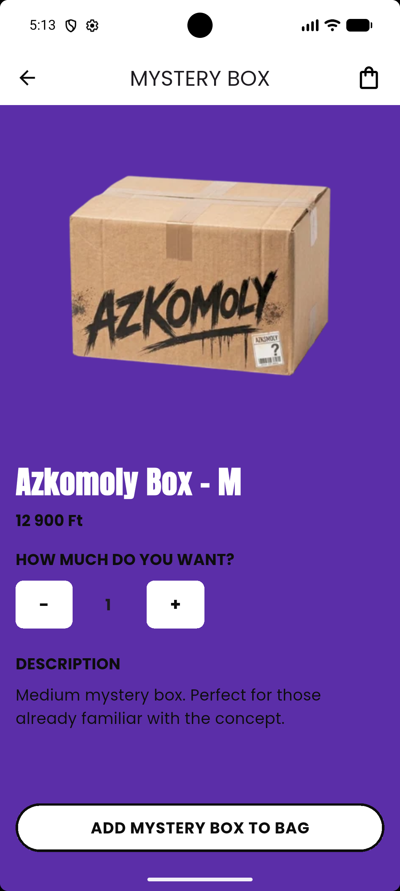
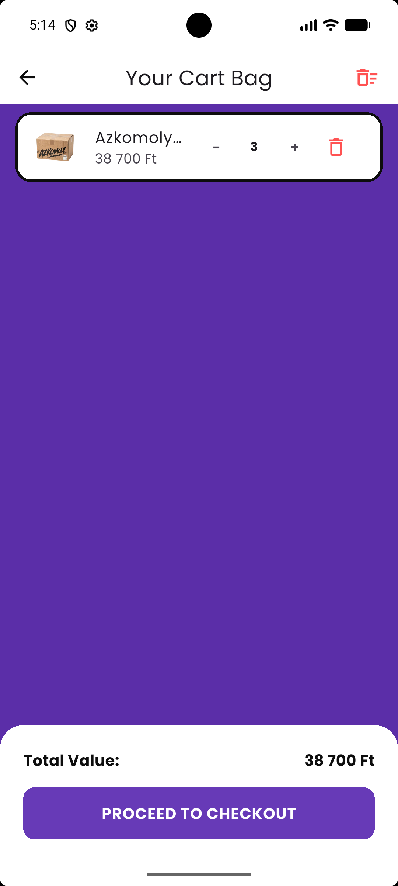

# ecommerce-flutter

Flutter storefront for the **Azkomoly e-commerce prototype**, developed during an internship. It uses a Go proxy for Shopify catalog and checkout-session operations and a hosted Shopify checkout WebView.

**Companion service:** [ecommerce-proxy](https://github.com/Khemio/ecommerce-proxy).

> **Status (November 24, 2026):** The catalog/cart baseline has passed local static analysis, 18 Flutter tests, eight user-reported runtime checks, and GitHub Actions CI. Checkout URL creation was verified; **successful payment and the order-result lifecycle were not**. This is a portfolio prototype, not a production-ready payment integration.

## Screenshots and demo

<p align="center">
  
  
  
</p>

<p align="center"><em>Catalog · Product details · Cart</em></p>

**[Watch the 43-second storefront demo](docs/azkomoly_storefront_demo.mp4)** — browsing, sorting, selecting products, and editing the cart. The video intentionally stops before payment.

See [demo details](docs/DEMO.md). These screenshots and the recording show the app on a test store; they are not evidence of successful payment.

## Verified storefront functionality

- Shopify-backed catalog, images, vendor and product-type filters, and price sorting.
- Product details, quantity selection, and adding products to the cart.
- Locally persisted cart, including quantity changes, removal, clearing, and app-restart recovery.
- Customer profile and address fields; English and Hungarian interface strings.
- Hosted Shopify checkout URL creation through the Go proxy, loaded in a Flutter WebView.
- A focused checkout HTTP client with tested request/response validation and error paths.
- Promotional and social carousels; a safe local banner fallback when the proxy does not serve `/config`.

**Checkout limitations:** `ShopProvider` can subscribe to `order.created` over SSE and show outcome screens, but order creation is not proof of payment. The current client also directly navigates from WebView/SSE callbacks; lifecycle resume verification and an authoritative payment-status lookup are not implemented. Do not treat the current success screen as verified payment confirmation.

## Architecture

```text
Flutter (Home / Product details / Cart / Profile)
    |
    +-- ShopProvider (catalog, cart, preferences, local order history)
    |        +-- SharedPreferences (device-local)
    |        +-- HTTP/JSON --> ecommerce-proxy (Go) --> Shopify Storefront API
    |        +-- SSE order.created <--- ecommerce-proxy <--- Shopify webhook
    |
    +-- CheckoutScreen (WebView) --> Shopify-hosted checkout
```

Shopify handles payment processing. The Flutter app and Go proxy do not process card details.

## Getting started

Prerequisites: a Flutter SDK compatible with `pubspec.yaml` (Dart `^3.12.2`), an Android/iOS development environment when testing the WebView, and the companion Go proxy configured with Shopify Storefront credentials.

Run the **proxy's `main` branch** on port 8080. Its current public API supports products, checkout creation with `sessionId`, SSE, and the Shopify webhook. It does not expose `/api/v1/config` or an authoritative checkout-status lookup.

```powershell
flutter pub get
flutter analyze
flutter test
flutter run --dart-define=BASE_URL=http://10.0.2.2:8080
```

`10.0.2.2` reaches the host computer from the standard Android emulator. For a physical phone use a reachable local-network address; for iOS simulator, `localhost` may work. `BASE_URL` is a compile-time Dart define and defaults to `http://localhost:8080`. Android debug builds allow local HTTP for testing; release deployments should use HTTPS.

To opt into a compatible custom `/config` endpoint, pass `--dart-define=ENABLE_REMOTE_CONFIG=true`. Otherwise the client builds local promotional banners from the available products and does not request the unsupported endpoint.

## Verification

- `dart format lib test`: 0 changed files.
- `flutter analyze`: **no issues found**.
- `flutter test`: **18 tests passed** (product, remote-order, cart-provider, checkout API and widget tests).
- Runtime smoke test, reported by the project owner: **8/8 passed** (catalog/images, filters, sorting, product details, cart editing, restart persistence, remove/clear persistence, and checkout URL creation).

Validation includes the checkout API tests added during portfolio polish. [GitHub Actions on `main` passed](https://github.com/Khemio/ecommerce-flutter/actions/runs/45433169586), running analysis and tests on a hosted runner.

These checks do **not** verify payment completion, signed webhook delivery, a bank app returning to the WebView, retries, or persistence of a pending checkout session.

## Code layout

| Location | Responsibility |
| --- | --- |
| `lib/main.dart` | Sets up the app and `ShopProvider` |
| `lib/features/main_layout.dart` | Home/cart/profile navigation |
| `lib/core/providers/shop_provider.dart` | Catalog, cart, local preferences, and current SSE hooks |
| `lib/core/models/` | Product, remote-order, profile, and UI models |
| `lib/features/home/` | Catalog, filters, promotion/social carousels |
| `lib/features/details/` | Product display and add-to-cart |
| `lib/features/cart/` | Cart, hosted checkout, request-validation client and provisional result screens |
| `lib/features/profile/` | Profile and local order history |
| `test/` | Focused Flutter tests |

## Documentation

- [Architecture](docs/ARCHITECTURE.md)
- [API integration](docs/API_INTEGRATION.md)
- [Branch history](docs/BRANCHES.md)
- [Checkout state design (proposal)](docs/CHECKOUT_STATE_DESIGN.md)
- [Testing](docs/TESTING.md)
- [Roadmap](docs/ROADMAP.md)
- [Demo and screenshots](docs/DEMO.md) — published screenshots, edited video, and the demonstration scope.

## Portfolio demonstration

The [edited demo](docs/azkomoly_storefront_demo.mp4) focuses on **catalog → sorting → product details → add to cart → cart quantity changes**. The screenshots above show the catalog, product details, and cart. Cart persistence across app restart was checked separately during manual testing, but is not demonstrated by the edited video.

Checkout URL creation was also manually verified, but payment completion and the order lifecycle remain unfinished. Checkout footage is excluded from the published video.

## Scope and data safety

This is a demonstrator, not a hardened commerce gateway. Profile, cart, and order history live in device-local `SharedPreferences`; there is no authenticated multi-device order history or recoverable verified-payment state. The remaining checkout work must distinguish confirmed payment, order creation, canceled/failed, and unknown/pending outcomes, and must never clear the cart or display paid success based solely on an SSE event or URL substring.
