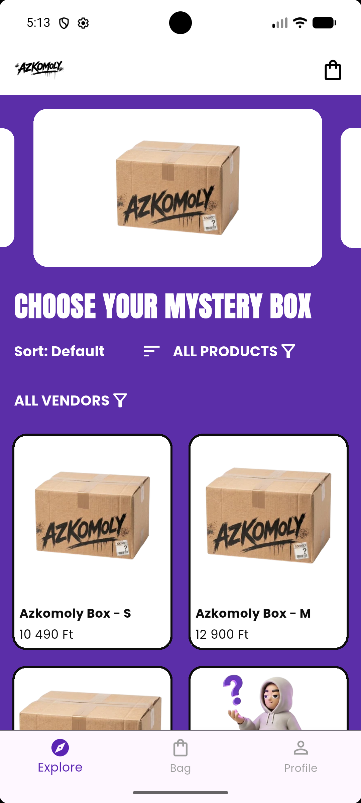
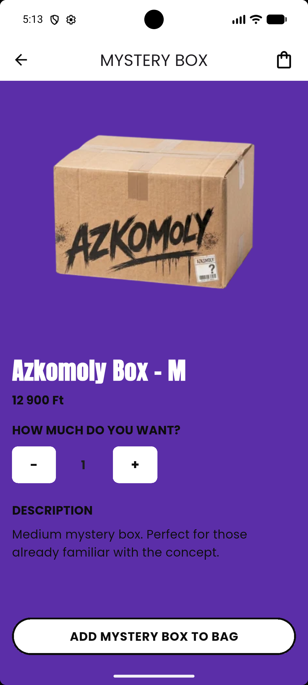
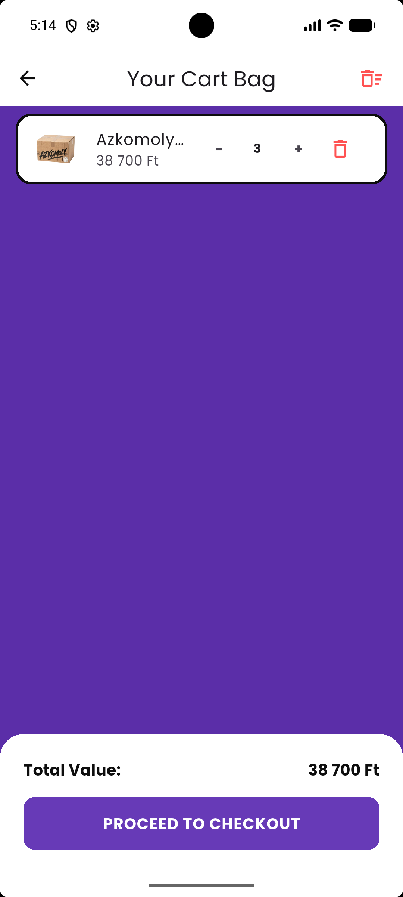

# Portfolio demo and screenshots

The media below was captured from the running Azkomoly Flutter storefront and prepared for portfolio review. It demonstrates the **catalog and cart**, not verified checkout payment.

## Screenshots

| Catalog | Product details | Cart |
| :---: | :---: | :---: |
|  |  |  |
| Shopify-backed products, filters and sorting | Product details and quantity selection | Editable cart and checkout entry point |

## Edited demo

**[Watch/download the storefront demo (MP4, about 43 seconds)](azkomoly_storefront_demo.mp4)**

The portrait recording focuses on:
1. Browsing and sorting products.
2. Opening a product and adjusting the quantity.
3. Adding products to the bag.
4. Editing quantities and removing cart items.

The edited clip deliberately excludes checkout/payment screens. **It does not show an app restart**; cart persistence across restart was verified separately in the owner's manual smoke test.

## What is verified, and what is not

- **Verified:** 18 local Flutter tests passed; local `flutter analyze` found no issues; GitHub Actions [passed on `main`](https://github.com/Khemio/ecommerce-flutter/actions/runs/45433169586); all eight reported storefront/cart smoke checks passed, including creation of a Shopify checkout URL.
- **Not verified:** a paid order, webhook-to-client payment confirmation, safe order archival, resumption from a banking app, or a complete checkout lifecycle. An `order.created` SSE event by itself does **not** prove payment.

The test Shopify store may be configured with a different base currency than the HUF prices displayed in Flutter. Previously captured checkout footage showed a large price discrepancy, so it is intentionally omitted until the store currency and price display are reconciled.

## Media files

| File | Purpose |
| --- | --- |
| [`catalog.png`](catalog.png) | README catalog screenshot |
| [`details.png`](details.png) | README product-details screenshot |
| [`cart.png`](cart.png) | README cart screenshot |
| [`azkomoly_storefront_demo.mp4`](azkomoly_storefront_demo.mp4) | Short edited portfolio video |

The original media files are retained unchanged. Before reusing any screenshots publicly, confirm that product imagery/branding from the internship project can be published.
